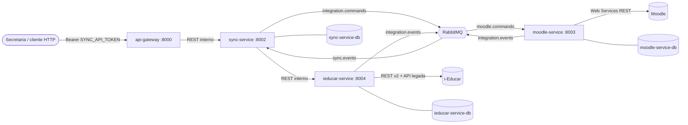
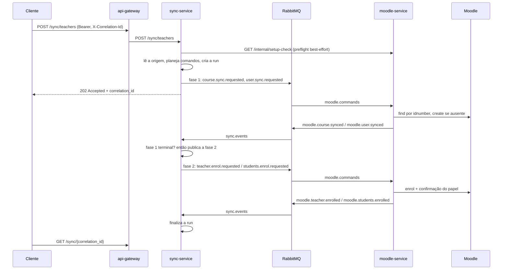

# Arquitetura — T2: Integração i-Educar × Moodle em microsserviços

Sincronização unidirecional **i-Educar → Moodle** de cursos, contas de professores e alunos e
matrículas, reprojetada a partir do monolito do T1 como microsserviços que se comunicam por mensagens.

- Decisões: [ADR-001 (decomposição)](./adr.md) e [ADR-002 (`moodle-service`)](./adr-moodle-service.md)
- Cenários de falha: [`failure-scenarios.md`](./failure-scenarios.md)
- Critérios de aceitação: [`acceptance-criteria.md`](./acceptance-criteria.md)
- Diagramas C4 no board do Miro do grupo — [abra por este convite](https://miro.com/welcomeonboard/bVlDenViaEhoM0pyeERsY3RlYUxwRzFERldOK1dDL3dFV3B1a1NIVUVIVnowTlI4MnJYTFF4Q2hROElvRVVJS1drM2k1SlFjeHRzWk1zVFIwYkNNZ3B5WWVKLzlNbXFic3lFUXpXZ3RGbU84TWx6ZkJFTlBiUll5SGJQbWZnN2dBS2NFMDFkcUNFSnM0d3FEN050ekl3PT0hdjE=?share_link_id=711145239564) para entrar como
  comentador; os links de cada nível abaixo só funcionam depois disso:
  - [Nível 1 — Context](https://miro.com/app/board/uXjVELtk9Y0=/?moveToWidget=3458764691046932186): a solução inteira, as duas pessoas e os dois sistemas externos
  - [Nível 2 — Containers](https://miro.com/app/board/uXjVELtk9Y0=/?moveToWidget=3458764691620358454): os quatro serviços, os bancos, o broker e as exchanges
  - Nível 3 — Components: [`ieducar-service`](https://miro.com/app/board/uXjVELtk9Y0=/?moveToWidget=3458764691620778839) ·
    [`moodle-service`](https://miro.com/app/board/uXjVELtk9Y0=/?moveToWidget=3458764691620901707) ·
    [`sync-service`](https://miro.com/app/board/uXjVELtk9Y0=/?moveToWidget=3458764691621190624)

## 1. Visão geral



Todos os caminhos existem no código. O `sync-service` escolhe a origem por configuração: o padrão em
`.env.example` continua `IEDUCAR_SOURCE=mock`, com um dataset de demonstração embutido, e
`IEDUCAR_SOURCE=http` passa a ler o `ieducar-service` em `IEDUCAR_SERVICE_URL` — o que exige
`IEDUCAR_TOKEN` e `IEDUCAR_ACCESS_KEY` preenchidos e a instância do i-Educar no ar.

## 2. Serviços e fronteiras

| Serviço | Porta | Dados próprios | Responsabilidade única |
| --- | --- | --- | --- |
| `api-gateway` | 8000 (pública) | nenhum | Borda: valida `Authorization: Bearer SYNC_API_TOKEN`, gera/propaga `X-Correlation-Id` e encaminha as rotas de sync |
| `sync-service` | 8002 (interna) | `sync-service-db` | Domínio: planeja os comandos, é dono do mapeamento de identidades, publica as fases e acompanha o progresso |
| `moodle-service` | 8003 | `moodle-service-db` | Adaptador de destino: consome comandos e aplica cursos, contas e matrículas no Moodle |
| `ieducar-service` | 8004 | `ieducar-service-db` | Adaptador de origem: encapsula as duas APIs do i-Educar, expõe `/internal/catalog`, `/internal/teachers`, `/internal/students` e avisa por evento quando um registro da origem muda |

Nenhum serviço acessa o banco de outro: cada um tem usuário, senha e banco próprios no
`docker-compose.yml`, em redes separadas (`sync-service-backend`, `moodle-service-backend`,
`ieducar-service-backend`, `moodle-backend`, `ieducar-backend`), e só a rede `integration` é
compartilhada. O `moodle-service` **não** acessa o banco do Moodle e o `ieducar-service` **não** acessa
o banco do i-Educar: cada um fala apenas com a API do sistema que adapta.

As credenciais dos sistemas externos ficam escondidas dentro do adaptador: `MOODLE_TOKEN` só existe no
`moodle-service`, `IEDUCAR_TOKEN` e `IEDUCAR_ACCESS_KEY` só no `ieducar-service`. O `sync-service`
coordena a sincronização sem conhecer nenhuma das duas.

O `api-gateway` é o único serviço sem diagrama de nível 3, porque não tem o que decompor: são três
componentes e nenhum estado — a validação do `Authorization: Bearer SYNC_API_TOKEN`, a geração ou
propagação do `X-Correlation-Id` e o proxy para o `sync-service`. Os outros três têm Components no
Miro, com uma caixa por módulo real do código.

## 3. Fluxo de uma sincronização

A sincronização roda em **duas fases**, porque matrícula depende de curso e conta já existirem.



Pontos que valem a pergunta da apresentação:

- A resposta é **202 Accepted** com o `correlation_id`: o cliente acompanha por `GET /sync/{id}`, não
  espera a sincronização terminar.
- O `sync-service` **não** publica a fase 2 inteira: para cada item ele checa se as dependências da
  fase 1 terminaram com sucesso e marca como `skipped` o que ficou órfão.
- Uma execução ativa do mesmo tipo responde **409 Conflict** com o snapshot da run em andamento
  (`SYNC_LOCK_SCOPE`).

## 4. Topologia RabbitMQ

Declarada pela própria aplicação na subida (`messaging/topology.py` dos dois serviços), nunca à mão.

| Exchange | Tipo | Quem publica |
| --- | --- | --- |
| `integration.commands` | topic, durable | `sync-service` (comandos) e o replay da DLQ |
| `integration.events` | topic, durable | `moodle-service` (resultados) e `ieducar-service` (avisos de mudança) |
| `integration.retry` | topic, durable | `moodle-service` (falha transitória) |
| `integration.dlx` | direct, durable | `moodle-service` (erro permanente ou retries esgotados) |

| Fila | Binding | Papel |
| --- | --- | --- |
| `moodle.commands` | `integration.commands` / `moodle.#.requested.v1` | Entrada do `moodle-service`, com `x-dead-letter-exchange: integration.dlx`. Consumo com ACK manual e `prefetch = RABBITMQ_PREFETCH_COUNT` |
| `moodle.commands.retry` | `integration.retry` / `#` | Espera `RABBITMQ_RETRY_TTL_MS` e, ao expirar, devolve a mensagem para `integration.commands` preservando a routing key original |
| `moodle.commands.dlq` | `integration.dlx` / `moodle.commands.dlq` | Erro permanente ou `RABBITMQ_MAX_RETRIES` esgotado. Reprocessável por `POST /internal/dlq/replay` |
| `sync.events` | `integration.events` / `moodle.#` | Entrada do `sync-service` para os eventos de resultado |

A fila `sync.events` assina **apenas** `moodle.#`, então os avisos `ieducar.*.changed.v1` são
publicados mas ainda não têm consumidor. Para o `sync-service` reagir a mudanças da origem basta
acrescentar o binding `ieducar.#` naquela fila — o aviso já carrega tudo o que o consumidor precisa.

O retry com espera é feito pela **fila de retry com TTL**, não por `nack(requeue=true)` em laço: a
mensagem sai da fila principal, aguarda e volta, sem ocupar o consumidor nem rodar em loop quente.

## 5. Catálogo de eventos

### Envelope (v1)

Todo comando e todo evento usa o mesmo envelope, validado por Pydantic nas duas pontas
(`messaging/schemas.py`):

| Campo | Tipo | Observação |
| --- | --- | --- |
| `message_id` | string (≤64) | Identidade da mensagem. É a chave do Inbox no `moodle-service` |
| `event_type` | string (≤128) | Nome canônico sem sufixo de versão (ex.: `moodle.course.sync.requested`) |
| `event_version` | `"1.0"` | Literal. Um envelope com outra versão é rejeitado |
| `correlation_id` | string (≤64) | Mesmo valor do `X-Correlation-Id`, atravessa todos os serviços e os logs |
| `causation_id` | string \| null | Nos eventos de resultado, o `message_id` do comando que os causou |
| `producer` | string | `sync-service` ou `moodle-service` |
| `occurred_at` | datetime ISO-8601 UTC | |
| `idempotency_key` | string (≤255) | Chave de negócio determinística (seção 6) |
| `payload` | objeto | Conteúdo específico do tipo |

A **routing key** é o `event_type` mais `.v1`. Mensagens persistentes
(`delivery_mode=PERSISTENT`) e `x-correlation-id` também no header, para inspeção na UI do broker.

Versionamento: uma mudança compatível (campo opcional novo) mantém `.v1`; uma mudança incompatível
cria `.v2` e uma nova routing key, de modo que o binding `moodle.#.requested.v1` continue entregando a
v1 ao consumidor atual até todos migrarem.

### Comandos — `integration.commands`, publicados pelo `sync-service`

| Routing key | Fase | Payload |
| --- | --- | --- |
| `moodle.course.sync.requested.v1` | 1 | `turma_id`, `disciplina_id`, `idnumber`, `shortname`, `fullname` |
| `moodle.user.sync.requested.v1` | 1 | `kind` (`teacher` \| `student`), `origin_id`, `idnumber`, `username`, `firstname`, `lastname`, `email` |
| `moodle.teacher.enrol.requested.v1` | 2 | `professor_id`, `turma_id`, `disciplina_id`, `user_idnumber`, `course_idnumber` |
| `moodle.students.enrol.requested.v1` | 2 | `turma_id`, `disciplina_id`, `course_idnumber`, `students[]` com `aluno_id` e `user_idnumber` (1 a 100 por lote) |

Exemplo:

```json
{
  "message_id": "9f1c...",
  "event_type": "moodle.course.sync.requested",
  "event_version": "1.0",
  "correlation_id": "demo-001",
  "causation_id": null,
  "producer": "sync-service",
  "occurred_at": "2026-11-24T12:00:00+00:00",
  "idempotency_key": "course:ieducar:curso:1:2026:10:2",
  "payload": {
    "turma_id": 10,
    "disciplina_id": 2,
    "idnumber": "ieducar:curso:1:2026:10:2",
    "shortname": "ieducar-1-2026-t10-d2",
    "fullname": "Matemática — 3A (turma 10) — 2026"
  }
}
```

### Eventos de resultado — `integration.events`, publicados pelo `moodle-service`

| Routing key | Significa | Payload |
| --- | --- | --- |
| `moodle.course.synced.v1` | Curso presente no Moodle | `idnumber`, `shortname`, `moodle_id`, `status` (`criado` \| `existente`), `reconciled` |
| `moodle.user.synced.v1` | Conta presente no Moodle | `kind`, `origin_id`, `idnumber`, `username`, `moodle_id`, `status`, `reconciled` |
| `moodle.teacher.enrolled.v1` | Papel docente confirmado | `user_idnumber`, `course_idnumber`, `moodle_user_id`, `moodle_course_id`, `status`, `reconciled`, `aviso` opcional |
| `moodle.students.enrolled.v1` | Lote processado | `course_idnumber`, `total`, `resumo` (`vinculado`/`existente`/`erro`), `resultados[]` |
| `moodle.course.sync.failed.v1` | Erro permanente ou retries esgotados | `erro`, `error_type` |
| `moodle.user.sync.failed.v1` | idem | `erro`, `error_type` |
| `moodle.teacher.enrol.failed.v1` | idem | `erro`, `error_type` |
| `moodle.students.enrol.failed.v1` | idem | `erro`, `error_type` |

Todo evento de resultado repete o `correlation_id` e o `idempotency_key` do comando e traz o
`message_id` do comando em `causation_id`. É assim que o `sync-service` casa o resultado com o item da
run sem manter estado em memória.

O campo `reconciled: true` marca que o efeito **já existia** quando a mensagem foi reprocessada: é a
evidência de idempotência que a demo do cenário 3 mostra.

### Avisos de mudança — `integration.events`, publicados pelo `ieducar-service`

| Routing key | Significa | Payload |
| --- | --- | --- |
| `ieducar.catalog.changed.v1` | Uma turma × disciplina entrou, mudou ou saiu do escopo | `entity_type`, `entity_key` (`{turma_id}:{disciplina_id}`), `change_type`, `identity`, `fingerprint`, `fetch_from` |
| `ieducar.teacher.changed.v1` | Um professor com vínculo vigente mudou | idem, `entity_key` = `professor_id` |
| `ieducar.student.changed.v1` | Um aluno ou sua enturmação mudou | idem, `entity_key` = `aluno_id` |

`change_type` é `created`, `updated` ou `removed`. O aviso é **magro**: diz o que mudou e em qual rota
buscar (`fetch_from`), e não leva o registro dentro. Assim a mensagem nunca fica desatualizada em
relação à origem e o consumidor sempre age sobre o dado atual, ao custo de uma leitura a mais.

```json
{
  "event_type": "ieducar.teacher.changed",
  "event_version": "1.0",
  "correlation_id": "scan-2026-11-24T12:00",
  "causation_id": "<scan_id>",
  "producer": "ieducar-service",
  "idempotency_key": "ieducar:teacher:7:3f9a...",
  "payload": {
    "entity_type": "teacher",
    "entity_key": "7",
    "change_type": "updated",
    "identity": {"professor_id": 7},
    "fingerprint": "3f9a...",
    "fetch_from": "/internal/teachers"
  }
}
```

## 6. Identidades determinísticas e idempotência

O `idnumber` é derivado dos identificadores do i-Educar, nunca sorteado
(`sync-service/app/domain/mapping.py`):

| Entidade | Formato |
| --- | --- |
| Curso | `ieducar:curso:{instituicao}:{ano}:{turma_id}:{disciplina_id}` |
| Professor | `ieducar:professor:{professor_id}` |
| Aluno | `ieducar:aluno:{aluno_id}` |

A `idempotency_key` do envelope é a chave do item na run: `course:<idnumber>`,
`user:teacher:<id>`, `user:student:<id>`, `teacher_enrol:<professor>:<curso>`.

A idempotência tem **duas camadas**:

1. **Inbox** (`processed_messages` no `moodle-service`): `claim_message` registra `message_id`,
   `idempotency_key` e o hash do payload. Uma mensagem já concluída volta como `duplicate`, com o
   resultado anterior em cache, e nada é reexecutado. Uma que já foi para a DLQ só roda de novo com
   replay explícito (`x-replayed`).
2. **Reconciliação no destino**: antes de criar, o handler procura pelo `idnumber` no Moodle
   (`find_course` / `find_user`). Se achar, adota o `moodle_id` e devolve `status: existente`. Mais de
   um registro com a mesma identidade é erro permanente, não tentativa de correção automática.

Os avisos do `ieducar-service` usam a mesma ideia com outra chave:
`ieducar:{entity_type}:{entity_key}:{fingerprint}` (ou `:removed`). A mesma mudança sempre produz a
mesma chave, então um consumidor pode deduplicar sem guardar histórico; e como o `fingerprint` muda a
cada alteração real, mudanças diferentes nunca colidem.

Matrícula segue a mesma ideia: o handler consulta os participantes do curso e **confirma o papel**
depois de matricular; um aviso pós-efeito do Moodle (por exemplo falha de SMTP) vira
`reconciled_after_warning`, não falha.

## 7. Dados de cada serviço

**`sync-service-db`** — runs e itens: progresso por `correlation_id`, fase de cada item, status
(`pending`, `published`, `succeeded`, `failed`, `skipped`), lock de execução concorrente e snapshot
devolvido por `GET /sync/{correlation_id}`.

**`moodle-service-db`**
- `processed_messages` — Inbox: status, tentativas, `reconciled`, resultado em cache por `message_id`.
- `moodle_entities` — `idnumber` → `moodle_id` para curso, professor e aluno.
- `moodle_enrolments` — auditoria das matrículas confirmadas, com `roleid` e aviso quando houve.

**`ieducar-service-db`**
- `source_fingerprints` — a memória da última leitura de cada registro da origem: `entity_type` +
  `entity_key`, o `fingerprint` (sha256 do conteúdo canônico), o snapshot, quando foi visto pela
  primeira e pela última vez, quando mudou e quando desapareceu. É o que permite dizer "isto mudou"
  em vez de republicar tudo.
- `scan_runs` — auditoria de cada varredura: gatilho (`startup`, `interval`, `manual`), status,
  contadores de registros lidos, mudanças detectadas e avisos publicados, duração e erro.

## 8. Resiliência

| Mecanismo | Onde | Configuração |
| --- | --- | --- |
| Timeout nas chamadas ao Moodle | `moodle-service` | `MOODLE_CONNECT_TIMEOUT`, `MOODLE_READ_TIMEOUT` |
| Retry local com backoff exponencial e jitter | `handlers.run_with_local_retry` | `LOCAL_MAX_RETRIES`, `LOCAL_RETRY_BASE_DELAY` |
| Retry distribuído por fila com TTL | `moodle.commands.retry` | `RABBITMQ_MAX_RETRIES`, `RABBITMQ_RETRY_TTL_MS`, header `x-retry-count` |
| Dead-letter queue | `moodle.commands.dlq` | replay por `POST /internal/dlq/replay?limit=N` |
| Circuit breaker (fechado, aberto, meio-aberto) | `moodle/circuit_breaker.py` | `CB_FAILURE_THRESHOLD`, `CB_RECOVERY_SECONDS` |
| ACK manual após o commit | consumidores dos dois serviços | `prefetch = RABBITMQ_PREFETCH_COUNT` |
| Reconexão em background ao broker | consumidores dos dois serviços | tenta a cada 2 s, sem derrubar o processo |
| Timeout, retry local e circuit breaker nas chamadas ao i-Educar | `ieducar-service` | `IEDUCAR_CONNECT_TIMEOUT`, `IEDUCAR_READ_TIMEOUT`, `LOCAL_MAX_RETRIES`, `CB_FAILURE_THRESHOLD`, `CB_RECOVERY_SECONDS` |
| Varredura da origem não concorrente e retomável | `ieducar-service` | trava em memória; varredura interrompida por queda é marcada `interrupted` na subida e a próxima roda normalmente |

A classificação do erro é explícita (`core/errors.py`): `TransientIntegrationError` vai para retry,
`PermanentDomainError` vai direto para a DLQ sem gastar tentativa, e `PostCommitNotificationError`
trata o caso em que o Moodle falhou **depois** de aplicar o efeito. Mensagens de erro são sanitizadas:
nada de token ou URL com segredo no log.

O `moodle-service` **não** declara `depends_on: moodle healthy` no Compose, de propósito: ele precisa
subir e operar com o Moodle fora do ar (cenário 2). Pelo mesmo motivo o `ieducar-service` depende
apenas do próprio banco e do RabbitMQ, nunca do i-Educar: com a origem fora, ele sobe, responde
`/health`, devolve 503 nas leituras e marca a varredura como `failed` até a origem voltar (cenário 1).

## 9. Observabilidade

- **Correlation ID**: entra como `X-Correlation-Id` (ou é gerado pelo gateway), vai no envelope e no
  header AMQP `x-correlation-id`, e é injetado no contexto de log dos dois serviços (`log_context`).
  Uma sincronização inteira é recuperável por um único valor, inclusive através do broker.
- **Health checks**: `GET /health` em todos os serviços (e o estado do consumidor nos que consomem) e
  `GET /ready` no `sync-service` e no `moodle-service`, checando banco, AMQP e circuit breaker. O
  Compose usa esses endpoints em `healthcheck` e `depends_on: condition: service_healthy`.
- **Métricas Prometheus** em `GET /metrics`:

| Serviço | Métrica |
| --- | --- |
| `sync-service` | `sync_runs_started_total`, `sync_runs_finished_total`, `sync_commands_published_total`, `sync_moodle_events_total`, `sync_run_duration_seconds` |
| `moodle-service` | `moodle_messages_processed_total{event_type,outcome}` (com `outcome` = `succeeded`, `duplicate`, `retried`, `dlq`), `moodle_message_processing_duration_seconds`, `moodle_api_requests_total`, `moodle_api_request_duration_seconds`, `moodle_circuit_breaker_state` |
| `ieducar-service` | `ieducar_scans_total{trigger,status}`, `ieducar_scan_duration_seconds`, `ieducar_records_read_total{entity_type}`, `ieducar_changes_published_total{entity_type,change_type}`, `ieducar_api_requests_total{resource,outcome}`, `ieducar_api_request_duration_seconds`, `ieducar_circuit_breaker_state` |

- **Auditoria por execução**: `GET /sync/{correlation_id}` no `sync-service`,
  `GET /internal/runs/{correlation_id}` no `moodle-service` e `GET /internal/scans` no
  `ieducar-service`.
- **Tracing distribuído** (desejável do enunciado) ainda não existe.

## 10. Comparação com o T1

| Aspecto | T1 (monolito) | T2 (microsserviços) |
| --- | --- | --- |
| Processos | 1 serviço FastAPI | 3 serviços no ar + 1 previsto, broker e 3 bancos |
| Comunicação interna | chamadas de função no mesmo processo | mensagens no RabbitMQ, mais 2 saltos REST (borda e preflight) |
| Resposta ao cliente | síncrona, durava o tempo da sincronização | `202 Accepted` com `correlation_id` e consulta de progresso |
| Falha do Moodle no meio | perdia a execução, era preciso repetir tudo | mensagem fica em retry com TTL ou DLQ e é reprocessada sem duplicar |
| Idempotência | pelo `idnumber` na hora de criar | `idnumber` **mais** Inbox por `message_id`, com resultado em cache |
| Credenciais | todas no mesmo processo | `MOODLE_TOKEN` só no `moodle-service`, `SYNC_API_TOKEN` só no gateway |
| Estado da execução | em memória | persistido no `sync-service-db`, sobrevive a restart |
| Observabilidade | log do processo | log estruturado com correlation ID atravessando serviços, health/ready e métricas por serviço |

**O que ficou mais caro**, e o grupo precisa saber defender:

- **Mais peças para operar**: 8 contêineres contra 3, três bancos para migrar e um broker cuja
  topologia precisa ser declarada corretamente na subida.
- **Consistência eventual**: entre o `202 Accepted` e o fim da sincronização existe uma janela em que o
  Moodle está parcialmente atualizado. O T1 era síncrono e não tinha esse estado intermediário.
- **Dependência entre fases**: a fase 2 só pode publicar depois da fase 1, o que exigiu persistir o
  progresso item a item e decidir o que fazer com o item órfão (hoje `skipped`).
- **Duplicação de contrato**: o envelope v1 e os nomes dos eventos existem nos dois serviços
  (`schemas.py` espelhado). Mudança de contrato agora toca dois repositórios de código.
- **Depuração mais difícil**: sem o correlation ID, uma falha vira caça a log em quatro lugares. A
  observabilidade deixou de ser conforto e passou a ser requisito.

## 11. Pendências

- O padrão do Compose segue `IEDUCAR_SOURCE=mock`. Virar a chave para `http` depende de preencher
  `IEDUCAR_TOKEN` e `IEDUCAR_ACCESS_KEY` da instância instalada e é uma decisão de configuração, não
  de código.
- Os avisos `ieducar.*.changed.v1` não têm consumidor: falta o binding `ieducar.#` na fila
  `sync.events` e o handler correspondente no `sync-service`.
- A leitura da origem no `sync-service` (`IEducarServiceClient`) tem timeout, mas **não** tem retry nem
  circuit breaker, e acontece dentro do `POST /sync/*` antes de a run ser criada. Ver o cenário 1 em
  [`failure-scenarios.md`](./failure-scenarios.md).
- Faltam os ADRs de comunicação, resiliência e stack. O ADR-001 descreve a comunicação interna como
  REST entre serviços, o que não corresponde mais ao código: hoje o caminho `sync-service` →
  `moodle-service` é todo por mensagem.
- Tracing distribuído não implementado.
- A reprodução dos cenários de falha deixou de ser manual: `scripts/demo_failure_scenarios.sh <1|2|3|4>`
  roda cada cenário com um comando e `scripts/reset_demo.sh` prepara o ambiente antes, preservando os
  tokens do `.env`.
